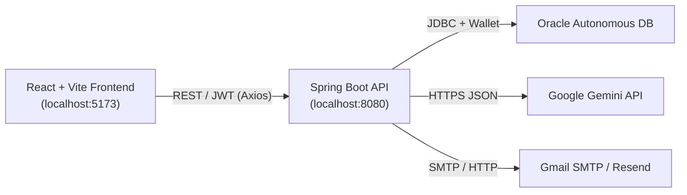

<div align="center">


# Alejandría UPC

**Collaborative academic repository, learning analytics & AI-assisted study platform for Universidad Popular del Cesar (UPC).**

Organize study repositories by subject and semester, share academic documents, collaborate with classmates, and turn repository materials into AI-generated quizzes, summaries, study guides, and slides.

[](LICENSE)


</div>

---

## Features

- **Institutional Auth & OTP Verification:** `@unicesar.edu.co` registration, BCrypt password hashing, stateless **JWT (HS256)** sessions, 6-digit **OTP email verification** (`console`, `smtp`, or `resend`), and token-based password recovery.
- **Academic Catalog & Study Repositories:** Curriculum catalog covering faculties, academic programs, semesters (1–9), and subjects, plus full CRUD for **Study Repositories** with likes, follows, topic tags, and **collaborator invitations**.
- **Document Management:** Upload, edit, delete, inline preview, and download academic files up to **25 MB** stored as Oracle BLOBs, with strict validation for `PDF`, `DOC`, `DOCX`, `PPT`, `PPTX`, `XLS`, `XLSX`, `JPG`, `JPEG`, and `PNG`.
- **Social Graph & Notifications:** Public profiles, user search, follow/unfollow, mutual **Friends** matching, and an in-app notification center.
- **AI Study Engine (Google Gemini):** Generates **Quizzes** (`QUIZ`), **Summaries** (`SUMMARY`), **Study Guides** (`GUIDE`), and **Slides** (`SLIDES`) from repository metadata, text snippets, and inline PDFs using `gemini-3.6-flash` (with multi-model Flash/Flash-Lite fallback), interactive quiz grading, daily quota (`ai.daily-limit=5`), **My Study** saved library, and mutual-friend sharing.
- **Learning Analytics & Moderation:** Asynchronous interaction tracking with **SHA-256 + salt** anonymization, CSV export, Recharts student/admin analytics dashboards, community reporting (`DOCUMENT`, `REPOSITORY`, `PROFILE`), and an admin moderation inbox (`KEEP`, `HIDE`, `REMOVE`, `WARN_USER`, `SUSPEND_USER`) with audit logs.
- **Modern UI & Mock-First Mode:** Built with React 19, Material UI (MUI v9), React Router v7, and Recharts, featuring Light/Dark themes and a `VITE_USE_MOCK` toggle to preview without a live backend.

---

## Tech Stack

| Layer | Technologies |
| :--- | :--- |
| **Backend (Root)** | Java 17, Spring Boot `3.4.13` (Web, Data JPA, Security, Validation, Mail), Maven |
| **Database** | Oracle Autonomous Database Cloud (`ojdbc11-production` `23.5.0.24.07` with Wallet), H2 (in-memory Oracle mode for tests) |
| **Frontend (`frontend/`)** | React `19.2`, Vite `8.3`, Material UI `9.5`, React Router DOM `7.18`, Axios `1.20`, Recharts `3.10` |
| **External Services** | Google Gemini API (Generative AI), SMTP / Resend HTTP API (Transactional Email) |

---

## Prerequisites

Make sure the following tools are installed before setting up the project (see also [`REQUIREMENTS.txt`](REQUIREMENTS.txt) for the full Spanish reference):

- **Java JDK 17+**: Verify with `java -version`.
- **Apache Maven 3.8+**: Verify with `mvn -version`.
  > This repository does **not** include a Maven wrapper (`mvnw` / `mvnw.cmd`). If `mvn` is not in your Windows `PATH`, run Maven goals from IntelliJ IDEA's integrated **Maven** tool window.
- **Node.js 18+** (`20+` or `22+` recommended) & **npm**: Verify with `node -v` and `npm -v`.
- **Git** for version control.
- **Oracle Database** *(only required to run the live backend)*:
  - **Oracle Autonomous Database Cloud** with your Wallet folder extracted locally (e.g., `C:/oracle/Wallet_AlejandriaBD2026`), or a local **Oracle XE / Oracle DB** instance.
  - **Database-First mode:** `spring.jpa.hibernate.ddl-auto=validate` expects the schema tables to exist beforehand.
  - **Automated tests (`mvn test`)** run against an in-memory **H2** database (`src/test/resources/schema-test.sql`), so **no Oracle instance is required** for tests.
- **Google AI Studio API Key** *(optional for boot, required for live AI Study generation)*: Obtain one at [Google AI Studio](https://aistudio.google.com/apikey).

---

## Install & Setup

### 1. Clone the repository

```bash
git clone https://github.com/sergioaguerrero/Alejandria.git
cd Alejandria
```

### 2. Configure the backend (`src/main/resources/application-local.properties`)

> **Security rule:** Never commit credentials, passwords, API keys, or your Oracle Wallet to Git. Both `src/main/resources/application-local.properties` and `frontend/.env.local` are ignored in [`.gitignore`](.gitignore).

[`application.properties`](src/main/resources/application.properties) loads defaults first, automatically imports `application-local.properties` if present (`spring.config.import=optional:classpath:application-local.properties`), and accepts OS environment variables.

Copy the template file:

```powershell
# Windows (PowerShell)
Copy-Item src/main/resources/application-local.properties.example src/main/resources/application-local.properties
```

```bash
# Git Bash / Linux / macOS
cp src/main/resources/application-local.properties.example src/main/resources/application-local.properties
```

Fill in the properties you need (or export the equivalent environment variables):

#### Oracle Database *(required for the live backend)*
| Property | Env Variable | Description / Example |
| :--- | :--- | :--- |
| `spring.datasource.url` | `SPRING_DATASOURCE_URL` | JDBC URL with Wallet path (use `/` on Windows): `jdbc:oracle:thin:@alejandriabd2026_high?TNS_ADMIN=C:/oracle/Wallet_AlejandriaBD2026` |
| `spring.datasource.username` | `SPRING_DATASOURCE_USERNAME` | Oracle username (default: `alejandria`) |
| `spring.datasource.password` | `SPRING_DATASOURCE_PASSWORD` | Oracle password *(no default)* |

#### Google Gemini AI *(required for `/api/ai/*`)*
| Property | Env Variable | Default / Description |
| :--- | :--- | :--- |
| `ai.api.key` | `AI_API_KEY` *(or `IA_API_KEY`)* | Google AI Studio API key (`AIzaSy...`). If empty, the backend boots normally but `/api/ai/*` returns HTTP `503` (`AI_NOT_CONFIGURED`). |
| `ai.api.url` | `AI_API_URL` | `https://generativelanguage.googleapis.com/v1beta/models/gemini-3.6-flash:generateContent?key=` *(automatic fallback to `gemini-3.5-flash`, `gemini-3.1-flash-lite`, `gemini-3.8-flash`, and `gemini-flash-lite-latest`)* |
| `ai.daily-limit` | `AI_DAILY_LIMIT` | `5` (daily AI generations per user) |
| `ia.timeout` | `IA_TIMEOUT` | `60000` (HTTP timeout in ms) |

#### Transactional Email *(OTP verification & password recovery)*
| Property | Env Variable | Description |
| :--- | :--- | :--- |
| `app.mail.provider` | `APP_MAIL_PROVIDER` | `console` \| `smtp` \| `resend` (default: `console`) |
| `app.mail.from` | `APP_MAIL_FROM` | Sender address (e.g., `Alejandria UPC <noreply@alejandria.local>`) |

Choose **one** provider in `application-local.properties`:
- **`console`** *(default for local dev)*: Prints 6-digit OTP codes and recovery links in the Spring Boot console prefixed with `[DEV-MAIL]`. No credentials required.
- **`smtp`** *(Gmail or custom SMTP)*: Set `spring.mail.host` (`MAIL_HOST`, e.g., `smtp.gmail.com`), `spring.mail.port` (`MAIL_PORT`, e.g., `587`), `spring.mail.username` (`MAIL_USERNAME`), and `spring.mail.password` (`MAIL_PASSWORD`). For Gmail, enable 2FA and use a **16-character App Password**—never your regular password.
- **`resend`** *(HTTP API for cloud/production)*: Set `app.mail.resend-api-key` (`RESEND_API_KEY`, format `re_xxxxxxxxx` from [Resend](https://resend.com/api-keys)) and `app.mail.resend-url` (`RESEND_API_URL`, default `https://api.resend.com/emails`).

#### Security, Verification, Analytics & Limits
| Property | Env Variable | Default / Purpose |
| :--- | :--- | :--- |
| `jwt.secret` | `JWT_SECRET` | `alejandria-dev-jwt-secret-change-in-production` *(use a 32+ char random secret in production)* |
| `jwt.expiration` | `JWT_EXPIRATION` | `86400000` (24 hours in ms) |
| `app.verification.hash-secret` | `VERIFICATION_HASH_SECRET` | `alejandria-dev-verification-secret-change-in-prod` |
| `analytics.salt` | `ANALYTICS_SALT` | `alejandria_analytics_salt_key_2026` |
| `app.frontend.url` | — | `http://localhost:5173` (used to build password reset links) |
| `cors.allowed.origins` | `CORS_ALLOWED_ORIGINS` | `http://localhost:5173` (`SecurityConfig` also permits `http://localhost:*` and `http://127.0.0.1:*`) |
| `spring.servlet.multipart.max-file-size` | `FILE_MAX_SIZE` | `25MB` |
| `spring.servlet.multipart.max-request-size` | `FILE_MAX_REQUEST_SIZE` | `25MB` |

*(OTP rules default to `code-length=6`, `expiration-minutes=15`, `max-attempts=5`, `resend-cooldown-seconds=60`, `unverified-cleanup-hours=48`.)*

### 3. Build, test & run the backend (port `8080`)

From the repository root:

```bash
mvn clean compile              # Compile the backend
mvn test                       # Run unit & integration tests (H2 in-memory, no Oracle required)
mvn clean package              # Package JAR -> target/alejandria-1.0.0.jar (or add -DskipTests)
mvn spring-boot:run            # Start the Spring Boot API at http://localhost:8080
# Or run the packaged JAR:
# java -jar target/alejandria-1.0.0.jar
```

### 4. Configure & run the frontend (`frontend/`, port `5173`)

Create `frontend/.env.local` from [`frontend/.env.example`](frontend/.env.example):

```powershell
# Windows (PowerShell)
cd frontend
Copy-Item .env.example .env.local
```

```bash
# Git Bash / Linux / macOS
cd frontend
cp .env.example .env.local
```

| Variable | Default (if unset) | Description |
| :--- | :--- | :--- |
| `VITE_API_URL` | `http://localhost:8080/api` | Spring Boot API base URL (no trailing `/`) |
| `VITE_USE_MOCK` | `true` | Set to `false` to consume the live backend; when omitted, defaults to `true` for standalone UI preview |
| `VITE_MOCK_DELAY` | `400` | Simulated delay in ms when `VITE_USE_MOCK=true` |

> **Important:** Always restart `npm run dev` after modifying `frontend/.env.local` so Vite reloads the variables.

```bash
npm install
npm run dev       # Start dev server at http://localhost:5173
```

Other frontend scripts:

```bash
npm run lint      # Run ESLint check
npm run build     # Build production bundle into frontend/dist
npm run preview   # Preview production bundle locally
```

### 5. Quick full-stack startup

1. **Terminal 1** (repository root): `mvn spring-boot:run`
2. **Terminal 2** (`frontend/`): `npm run dev`
3. Open `http://localhost:5173` in your browser.

---

## How It Works & Project Structure



```text
AlejandriaUPC/
├── pom.xml                                  # Maven configuration (Spring Boot 3.4.13, Java 17)
├── REQUIREMENTS.txt                         # Full Spanish setup, API keys & troubleshooting reference
├── src/
│   ├── main/java/com/backend/
│   │   ├── config/                          # CORS, Security, RestTemplate, Mail & Verification properties
│   │   ├── controller/                      # REST controllers (/api/**)
│   │   ├── service/                         # Business rules, AI client, JWT, email, analytics, moderation
│   │   ├── repository/                      # Spring Data JPA repositories
│   │   ├── domain/                          # JPA entities (academy, ai, analytic, governance, identity, repos)
│   │   ├── dto/                             # Request & response DTOs
│   │   ├── cross/                           # Shared domain enums (AiContentType, ReportReason, etc.)
│   │   └── exception/                       # GlobalExceptionHandler & custom exceptions
│   ├── main/resources/
│   │   ├── application.properties           # Default configuration & env-var placeholders
│   │   └── application-local.properties.example
│   └── test/                                # Unit & integration tests (H2 Oracle mode)
├── frontend/
│   ├── package.json                         # Frontend scripts & dependencies
│   ├── vite.config.js                       # Vite dev server with /api -> localhost:8080 proxy
│   ├── .env.example                         # Frontend environment template
│   └── src/
│       ├── components/                      # Reusable UI components (layout, forms, AI, documents, admin)
│       ├── context/                         # AuthProvider & ThemeModeProvider
│       ├── mocks/                           # Mock datasets & in-memory mock store
│       ├── pages/                           # Views (auth, home, repositories, documents, ai, admin, profile, stats)
│       ├── routes/                          # Role-aware ProtectedRoute
│       ├── services/                        # Axios client & domain service modules
│       ├── theme/                           # MUI Light/Dark theme definitions
│       └── utils/                           # Validation, formatting, topics, and chart helpers
└── docs/                                    # Architecture diagrams, backlogs & AI usage logs
```

---

## API Endpoints Overview

| Module | Endpoints |
| :--- | :--- |
| **Auth** | `POST /api/auth/register`, `POST /api/auth/verify-email`, `POST /api/auth/resend-verification`, `POST /api/auth/login`, `POST /api/auth/recover`, `POST /api/auth/reset` |
| **Catalog** | `GET /api/subjects`, `GET /api/subjects/{id}` *(also `/api/catalog/subjects`)* |
| **Users & Social** | `GET /api/users`, `GET /api/users/{username}`, `POST /api/users/{username}/follow`, `PUT /api/users/me`, `PUT /api/users/me/password`, `GET /api/users/me/friends`, `GET /api/users/me/following`, `GET /api/users/me/followers`, `GET/PUT /api/users/me/subjects`, `GET /api/users/me/collaborations`, `GET /api/users/me/statistics` |
| **Repositories** | `GET/POST /api/repositories`, `GET /api/repositories/followed`, `GET/PUT/DELETE /api/repositories/{id}`, `POST /api/repositories/{id}/like`, `POST /api/repositories/{id}/follow`, `GET /api/users/{username}/repositories` |
| **Collaborators** | `GET/POST /api/repositories/{id}/collaborators`, `POST /api/repositories/{id}/collaborators/respond`, `DELETE /api/repositories/{id}/collaborators/{username}` |
| **Documents** | `POST/GET /api/repositories/{repositoryId}/documents`, `GET /api/documents`, `GET /api/users/{username}/documents`, `GET/PUT/DELETE /api/documents/{id}`, `GET /api/documents/{id}/download`, `GET /api/documents/{id}/preview` |
| **AI Study** | `GET /api/ai/quota`, `POST /api/ai/quiz`, `GET /api/ai/quiz/{id}`, `POST /api/ai/quiz/{id}/submit`, `POST /api/ai/quiz/{id}/save`, `POST /api/ai/materials`, `GET /api/ai/materials/{id}`, `POST /api/ai/materials/{id}/save`, `GET /api/ai/my-study`, `DELETE /api/ai/my-study/{id}`, `GET/POST /api/ai/materials/{id}/share(s)`, `GET /api/ai/shared-with-me` |
| **Notifications** | `GET /api/notifications`, `GET /api/notifications/unread-count`, `PUT /api/notifications/{id}/read`, `PUT /api/notifications/read-all` |
| **Analytics** | `POST /api/analytics/interaction`, `GET /api/analytics/top-subjects`, `GET /api/analytics/export` |
| **Moderation & Admin** | `POST /api/reports`, `GET /api/admin/reports`, `GET /api/admin/reports/{id}`, `POST /api/admin/reports/{id}/resolve`, `GET /api/admin/users/{userId}`, `POST /api/admin/users/{userId}/toggle-suspension`, `GET /api/admin/statistics`, `GET /api/admin/statistics/advanced` |

---

## Troubleshooting

<details>
<summary><b><code>mvn</code> is not recognized as a command (Windows)</b></summary>

Install Apache Maven and add its `\bin` directory to your system `PATH`, or run the same lifecycle goals from IntelliJ IDEA's integrated **Maven** panel (`Lifecycle` / `Plugins -> spring-boot:run`).
</details>

<details>
<summary><b>Frontend still loads mock data while Spring Boot is running</b></summary>

Check `frontend/.env.local` and confirm `VITE_USE_MOCK=false` (if the variable or `.env.local` is missing, it defaults to `true`). Restart `npm run dev` after editing `.env.local`.
</details>

<details>
<summary><b>Oracle / <code>ORA</code> / <code>TNS_ADMIN</code> connection errors</b></summary>

Verify that your Oracle Wallet is extracted to the exact path set in `spring.datasource.url` (using `/` instead of `\` on Windows) and confirm `spring.datasource.username` and `spring.datasource.password` are correct.
</details>

<details>
<summary><b>HTTP <code>503 AI_NOT_CONFIGURED</code> in AI Study</b></summary>

Set `ai.api.key` in `src/main/resources/application-local.properties` (or pass the `AI_API_KEY` environment variable).
</details>

<details>
<summary><b>OTP verification emails do not arrive</b></summary>

- With `app.mail.provider=console`, look for `[DEV-MAIL]` in the Spring Boot console output.
- With `smtp` (Gmail), make sure `spring.mail.password` is a **16-character App Password** (not your normal Gmail password) and `app.mail.from` matches your Gmail address.
- With `resend`, check `app.mail.resend-api-key` and verify that your sender/domain is enabled in your Resend account.
</details>

---

## Team & Roles

* **Sergio Alejandro Guerrero Espitia** — Full-Stack Developer & System Integrator
  * Built the complete **React + Vite + Material UI** frontend (`frontend/`), service layer, Light/Dark theme, and mock-first workflow.
  * Implemented the **AI Study Engine** end-to-end (Google Gemini integration with multi-model fallback, Quizzes/Summaries/Guides/Slides generation, daily quota, **My Study** library, and mutual-friend sharing).
  * Developed full-stack backend & frontend modules for JWT authentication & 6-digit OTP email verification (`console`/`smtp`/`resend`), Study Repositories & Collaborators, Document CRUD/preview & topic normalization, Social network (follows/friends) & Notifications, Personal/Global/Advanced Statistics, Moderation & Admin User management, Oracle Cloud Database-First alignment, and integration tests.
* **José Daniel Pinzón Racero** — Technical Lead / Backend Developer
  * Defined the Spring Boot layered architecture, initial Maven/Oracle Cloud setup, `SecurityConfig` & `CorsConfig`, global exception handling (`GlobalExceptionHandler`, `ErrorResponse`), initial service/controller scaffolding, and architecture/class diagrams (`docs/`).
* **Pablo Andrés Amaya Pabón** — Backend Developer
  * Designed and implemented the core JPA domain entities (`academy`, `analytic`, `governance`, `identity`, `repos`), cross-cutting domain enums, base Spring Data JPA repositories, and initial asynchronous `AnalyticsService`.

---

## License

[MIT](LICENSE) © 2026 Alejandría UPC
